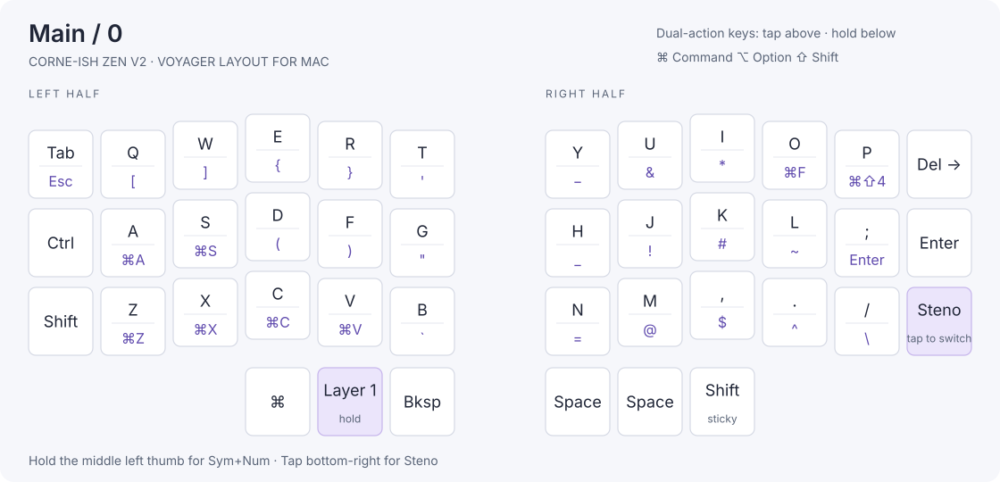
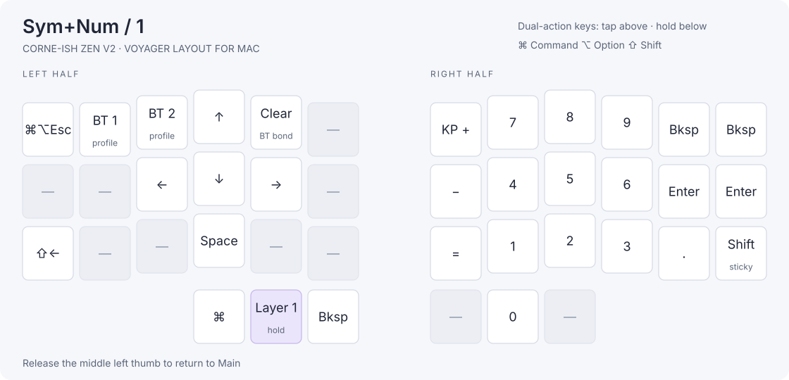
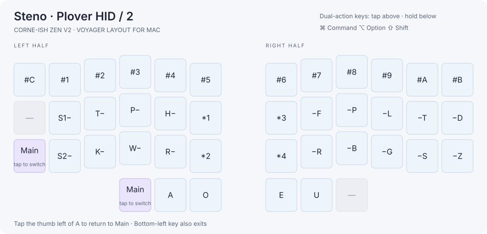

# Corne-ish Zen V2 — Plover HID + Voyager Mac Keymap

This configuration uses upstream ZMK main commit
[`4dd95d7840eb3d5a3f59bb29fbf1ab054715ef85`](https://github.com/zmkfirmware/zmk/commit/4dd95d7840eb3d5a3f59bb29fbf1ab054715ef85),
the latest upstream commit fetched during this migration. Both the west manifest
and reusable build workflow are pinned to it so the builds are reproducible.
The matrix explicitly selects **V2 / revision 2.0.0**, matching the old targets.

The keymap now follows the supplied Voyager layout: **MAIN (0)**,
**SYM+NUM (1)**, and **STENO (2)**. The unused Voyager number row is omitted
because the Zen has three main rows. Detailed diagrams and tap/hold actions
are in [KEYMAP.md](KEYMAP.md).

Hold-tap keeps the 200 ms tapping term, 125 ms quick-tap and prior-idle settings.
Sleep remains 15 minutes. The display uses upstream Zen defaults.

### Layer graphics

Tap actions appear above the divider; hold actions appear below. The diagrams
are generated directly from the firmware keymap.

#### Main · 0

#### Sym+Num · 1

#### Steno · 2

To refresh these graphics after editing the keymap, run
`python3 scripts/render_keymap.py`.

### Layer controls and Mac translation

- Hold the **middle left thumb key** for SYM+NUM; release it to return.
- Tap the **outer right thumb key** to enter STENO.
- The **bottom-right main key** is sticky Shift (also available on SYM+NUM).
- In STENO, tap the **left thumb key immediately left of A** to return to MAIN.
  The bottom-left main-row key also returns to MAIN.
- A/S/Z/X/C/V/O hold actions send **Command+A/S/Z/X/C/V/F**.
- Hold **P** for **Command+Shift+4** (screenshot selection).
- Hold **semicolon** for ordinary **Enter**, as requested.
- Hold B for grave/backtick; the top-right main key is forward Delete.
- Physical Control and Shift, punctuation holds, arrows, and Shift+Left stay as shown.
- The old separate SYMBOL and GAMING layers are removed.
- Zen has one extra thumb key per half: left outer stays Command; right outer
  enters STENO. The two Voyager right thumb positions both send Space.
- Voyager LED controls are omitted. On SYM+NUM, Q selects Bluetooth profile 1,
  W selects profile 2, and R clears the selected profile. Other LED positions
  are disabled. The top-left SYM+NUM key opens the Mac Force Quit dialog
  (Command+Option+Escape), replacing the Windows Control+Alt+Delete action.

### Plover HID

Use **Plover → Configure → Machine → Plover HID**, then connect to the Zen.
Leave Plover output enabled: MAIN and SYM+NUM send ordinary keyboard reports
and bypass Plover's steno input. Connect the left half by USB for initial testing;
the right half continues to communicate with it wirelessly.

The pinned module is
[`petercpark/zmk-hid-io-plover-hid@d895457`](https://github.com/petercpark/zmk-hid-io-plover-hid/commit/d895457418590dddf628c5ae907b39deec7095ff).
It sends an eight-byte state bitmap with usage page `0xFF50`, usage `0x4C56`,
and report ID `0x50`. NKRO is not enabled. Each physical S, star and number-bar
key uses its own report index. Translation and dictionaries live in Plover.

The previous build has been physically tested over USB by the user; macOS also
enumerated its Plover HID interface over Bluetooth. The Voyager keymap revision
still needs its own physical key-by-key and chord tests after flashing.

### Build and flash

Open the **Build Zen firmware** Actions run for the update branch and download
its `firmware` artifact after both halves pass. Flash
`corneish_zen_v2_left.uf2` to the left half and
`corneish_zen_v2_right.uf2` to the right half: connect that half by USB,
double-tap its reset button to mount the bootloader drive, then copy its matching
UF2 file onto the drive. Repeat for the other half. Keep the previous working
firmware as a rollback copy.

When migrating from older Zen firmware, update both halves together. Subsequent keymap-only changes are handled by the left central half.
Adding the steno interface alters the HID descriptors: forget the old keyboard pairing on
the host, clear that host profile on the Zen using SYM+NUM + R
(BT_CLR), and pair again. Try USB first to verify ordinary typing and Plover
chords. Flashing and physical/Bluetooth tests must be done on the actual keyboard.

References: [Plover HID protocol](https://github.com/dnaq/plover-machine-hid),
[Plover setup](https://plover.wiki/index.php/Beginner%27s_Guide), and
[Zen support and bootloader instructions](https://lowprokb.ca/pages/corne-ish-zen-support).

## Sources

This configuration was adapted from [my original Zen configuration](https://github.com/disarmyouwitha/zmk-config-zen-2) and the [LOWPROKB Zen V2 configuration](https://github.com/LOWPROKB/zmk-config-zen-2). Firmware and board support come from [ZMK](https://github.com/zmkfirmware/zmk); the dedicated steno interface comes from [petercpark’s Plover HID module](https://github.com/petercpark/zmk-hid-io-plover-hid).
